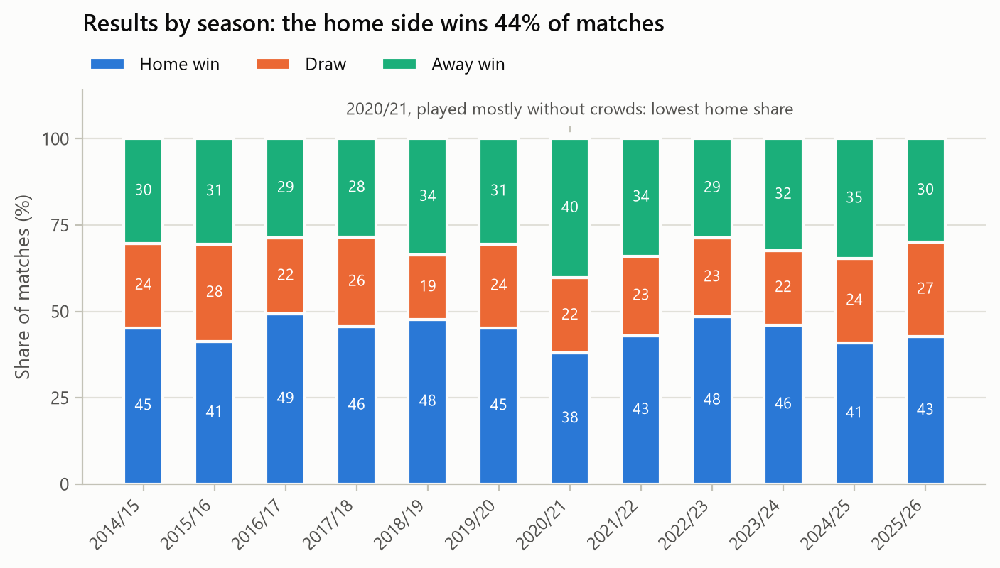
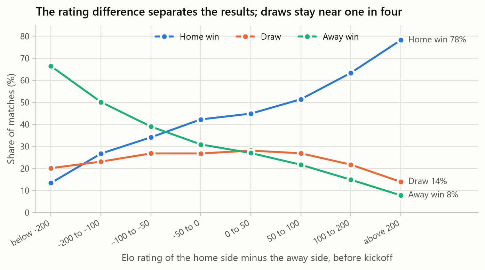
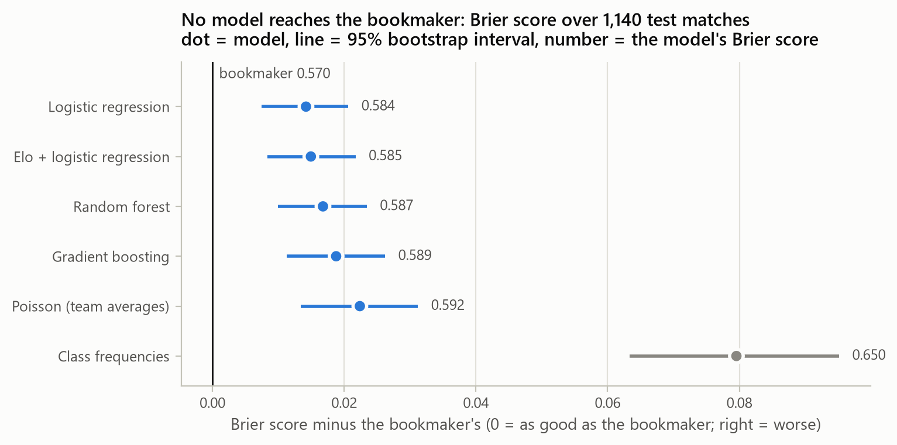
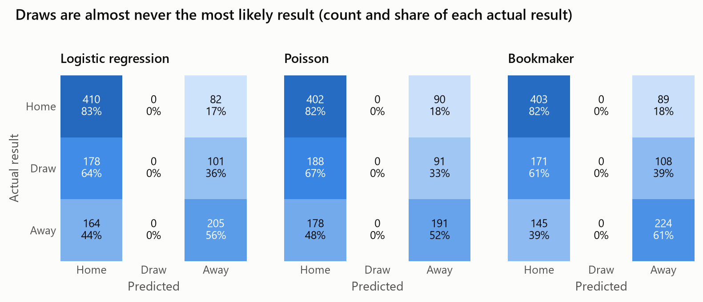
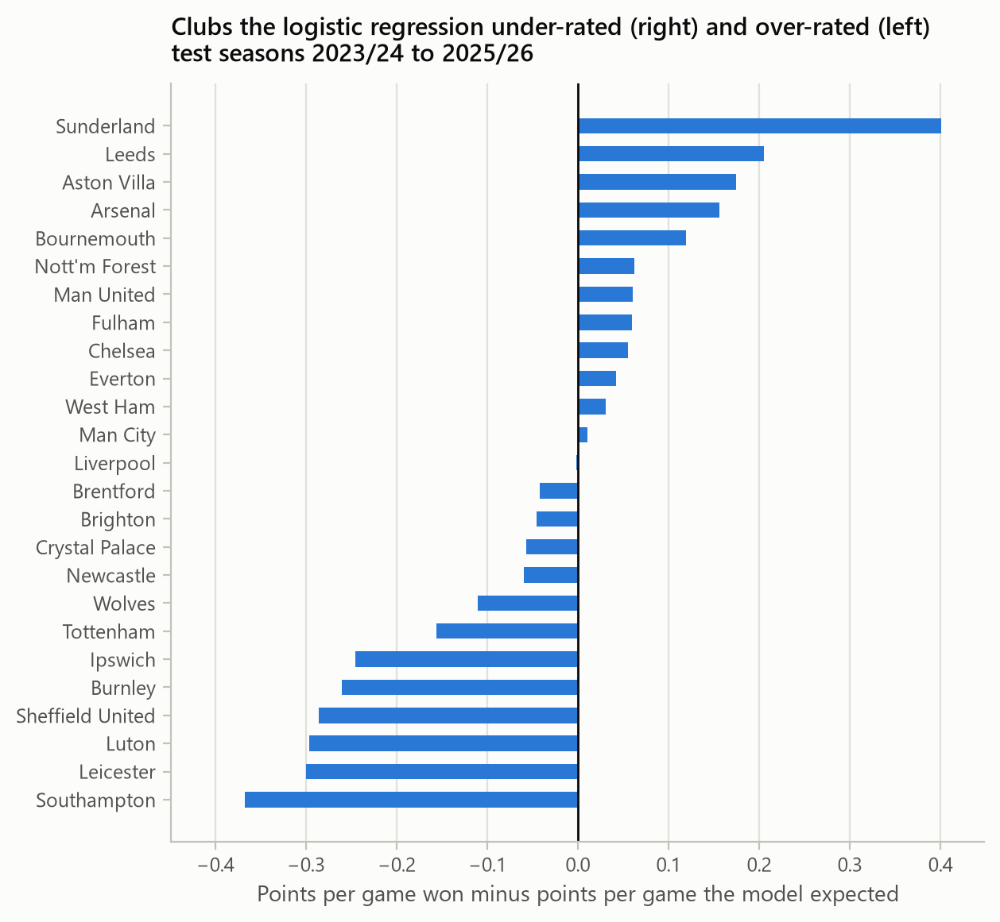

# Predicting Premier League match results

Course project for IAPD. The question: how well can the result of a Premier
League match (home win, draw, away win) be forecast before kickoff from public
data, and how close do such forecasts get to the bookmaker's odds?

Twelve seasons of results, match statistics and odds are downloaded from
Football-Data.co.uk, cleaned into a match table and a table of pre-match
features, explored, and used to train six models. Every model predicts the
last three seasons without seeing the future and is scored against Bet365's
odds at kickoff. An error analysis shows where the forecasts fail.

## Repository structure

| Folder | Contents |
| :--- | :--- |
| [`extraction/`](extraction) | Crawling and preprocessing: `download.py` fetches the season files, `preprocess.py` cleans them into one match table, `features.py` builds the modelling table. |
| [`analysis/`](analysis) | `eda.py` (exploratory analysis), `poisson.py` and `models.py` (the models), `compare_models.py` (training, walk-forward evaluation, comparison), `error_analysis.py`, `predict.py` (forecast one fixture). Result tables are in `analysis/results/`. |
| [`data/`](data) | `raw/`: the twelve season files as downloaded. `final/`: `matches.csv` and `features.csv`. Described in [`data/README.md`](data/README.md). |
| [`docs/`](docs) | The final report ([PDF](docs/final_report.pdf), [Word](docs/final_report.docx)), the two presentations ([phase 1](docs/phase1_presentation.pptx), [phase 2](docs/phase2_presentation.pptx), each also as PDF) with their speaker notes ([phase 1](docs/phase1_speaker_notes.md), [phase 2](docs/phase2_speaker_notes.md)), and the figures. |
| [`tests/`](tests) | Offline tests of the cleaning, the features, the models and the scores. |

## How to run

```bash
pip install -r requirements.txt

python -m extraction.download --seasons 2014-2025   # raw season files into data/raw
python -m extraction.preprocess                      # data/final/matches.csv
python -m extraction.features                        # data/final/features.csv

python -m analysis.eda                               # descriptive statistics and figures
python -m analysis.compare_models                    # train, predict three seasons, compare
python -m analysis.error_analysis                    # where the forecasts go wrong
python -m analysis.predict "Arsenal" "Chelsea"       # probabilities and score grid for one fixture

python -m pytest tests                               # offline tests
```

The data is already in the repository, so the analysis runs without the
download step.

## Data

**Acquisition.** [Football-Data.co.uk](https://www.football-data.co.uk/englandm.php)
publishes one CSV file per league and season. `extraction/download.py` builds
the address of each Premier League season
(`https://www.football-data.co.uk/mmz4281/2324/E0.csv` for 2023/24), sends one
request per season with a pause in between, checks that the reply is a match
file and saves it untouched in `data/raw`. Files already there are skipped.

**Preprocessing.** `extraction/preprocess.py` reads the twelve files into one
table: the two date formats the site has used are unified, blank rows
dropped, 31 of up to 132 raw columns kept under readable names, the result
derived from the score. `extraction/features.py` then computes, for every
match, 21 features from the matches played *before* it: an Elo rating for each
side, form over the last five matches (points, goals, shots on target),
strength over the last 38, form at the venue and days of rest. A test checks
that changing a result changes only the features of later matches.

**The dataset.**

| | |
| :--- | :--- |
| Matches | 4,560, in 12 complete seasons (2014/15 to 2025/26) |
| Clubs | 35 |
| Columns | 31 in `matches.csv`; 21 features in `features.csv` |
| Results | home win 44.4%, draw 23.8%, away win 31.8% |
| Goals per match | 2.80 (home 1.54, away 1.26) |
| Missing values | odds at kickoff and over/under odds exist from 2019/20 only (1,900 earlier matches); nothing else is missing |

## Exploratory analysis

`python -m analysis.eda` prints the descriptive statistics and draws the
figures in `docs/figures`.

* **Home advantage.** The home side wins 44% of matches. The one exception is
  2020/21, played mostly without crowds: home wins fell to 38% and away wins
  rose to 40%.
* **Goals are close to Poisson.** Every observed share of 0, 1, 2, ... goals
  by the home side is within 1.9 points of a Poisson distribution with the
  same mean. The most frequent score is 1-1 (10.8% of matches).
* **Long-run strength carries the signal.** With an Elo lead above 200 the
  home side wins 78% of matches; with a deficit below −200, 13%. Draws stay
  between 14% and 28% whatever the difference. Ratings and season-long goals
  correlate most with the result, five-match form less, rest days not at all.





## Models and evaluation

| Model | What it uses |
| :--- | :--- |
| Class frequencies | The share of home wins, draws and away wins in the training matches: the floor. |
| Elo + logistic regression | One feature, the Elo rating difference. |
| Poisson goal model | Each club's attack and defence strength relative to the league average give the expected goals of both sides; a 7×7 score grid gives the probability of every score and, summed, of each result. |
| Logistic regression | All 21 features, multinomial, regularised. |
| Random forest | 400 trees on the 21 features. |
| Gradient boosting | Shallow boosted trees on the 21 features. |

**Protocol.** Seasons are used in time order. 2014/15 only warms up the
ratings and the form features. Settings are chosen on two validation seasons
(2021/22 and 2022/23) by log loss and then frozen. The test is the last three
seasons, 1,140 matches: before each one a model is refitted on every earlier
season, and the Poisson model is refitted before every match day on the two
previous seasons plus the season so far. No forecast uses information from
its own day or later. Forecasts are scored by accuracy, Brier score (mean
squared error of the three probabilities, lower is better) and log loss, and
compared with Bet365's odds at kickoff with the margin removed.

## Results

Test seasons 2023/24 to 2025/26, 1,140 matches:

| Model | Accuracy | Brier | Log loss | Brier gap to the bookmaker (95% interval) |
| :--- | ---: | ---: | ---: | :--- |
| Logistic regression | 53.9% | 0.584 | 0.980 | +0.014 (+0.007 to +0.021) |
| Elo + logistic regression | 53.4% | 0.585 | 0.981 | +0.015 (+0.008 to +0.022) |
| Random forest | 53.6% | 0.587 | 0.986 | +0.017 (+0.010 to +0.023) |
| Gradient boosting | 52.5% | 0.589 | 0.990 | +0.019 (+0.011 to +0.026) |
| Poisson goal model | 52.0% | 0.592 | 0.994 | +0.022 (+0.013 to +0.031) |
| Class frequencies | 43.2% | 0.650 | 1.073 | +0.080 (+0.063 to +0.095) |
| **Bookmaker (Bet365 at kickoff)** | **55.0%** | **0.570** | **0.960** | reference |

Brier score by season:

| Model | 2023/24 | 2024/25 | 2025/26 |
| :--- | ---: | ---: | ---: |
| Logistic regression | 0.544 | 0.589 | 0.620 |
| Elo + logistic regression | 0.545 | 0.590 | 0.620 |
| Random forest | 0.549 | 0.591 | 0.621 |
| Gradient boosting | 0.548 | 0.595 | 0.624 |
| Poisson goal model | 0.560 | 0.597 | 0.620 |
| Class frequencies | 0.637 | 0.656 | 0.656 |
| Bookmaker | 0.526 | 0.576 | 0.608 |

* **No model reaches the bookmaker.** The best one, logistic regression, is
  0.014 Brier behind, and the bootstrap interval of every gap excludes zero.
* **All models are far better than the floor** (0.584 against 0.650).
* **More complexity did not help.** The rating difference alone does as well
  as all 21 features, and the tree models are slightly worse: with a few
  thousand training matches and a noisy target, the simple model wins.



Example forecast from the Poisson model (fitted on the last two seasons):
Arsenal v Chelsea, expected goals 1.77 to 0.96, home 56.5%, draw 23.3%, away
20.2%, most likely score 1-0 (11.6%).

## Error analysis

`python -m analysis.error_analysis` compares the errors of the best model
(logistic regression), the Poisson model and the bookmaker.

* **Draws are never predicted.** 279 of the 1,140 test matches (24.5%) were
  draws, and neither the model nor the bookmaker ever rates a draw as the most
  likely result: the highest draw probability the model gives is 30%. This
  caps accuracy near 55% for everyone.
* **The probabilities are well calibrated.** Predicted probability and
  observed frequency differ by at most 2.5 points in any bin, so the errors
  are not a calibration problem.
* **Even matches are the hard ones.** Where the favourite is below 45% the
  model's Brier score is 0.671 (bookmaker 0.652); with a favourite above 65%
  it is 0.404 (bookmaker 0.392).
* **When the model disagrees with the bookmaker, the model is wrong.** In
  557 matches the two forecasts are within 5 points and score the same (0.548
  and 0.547). In the 182 matches where they differ by more than 10 points the
  bookmaker is far ahead (0.610 against 0.672). Betting one unit wherever a
  model sees more than 5% expected value at the kickoff odds loses money for
  every model, from −7.0% (Elo) to −18.5% (Poisson).
* **Clubs new to the league are the blind spot.** The eight largest errors
  per club are all clubs that spent only one or two of the three seasons in
  the league: Sunderland and Leeds did better than the model expected,
  Southampton, Leicester, Luton, Sheffield United, Burnley and Ipswich worse.
  A promoted club arrives with no history.
* **Upsets surprise everyone.** The result the model thought least likely,
  Liverpool 0-1 Crystal Palace (6%), was unlikely for the bookmaker too (9%).
* **Exact scores are mostly luck.** The Poisson model's most likely score was
  right in 11.1% of matches; always saying 1-1 would be right in 11.4%.





## Conclusions

A simple, well calibrated model built on public results gets most of the way
to the bookmaker: 54% accuracy and a Brier score of 0.584, against 0.570 for
the odds and 0.650 for the class frequencies. The remaining gap is
information that results alone do not contain, such as line-ups, injuries and
transfers. The error analysis points to what to try next: squad and line-up
data, a model aimed at draws, and better starting ratings for promoted clubs.

## Tests

`python -m pytest tests` runs seven offline tests on a small simulated league:
the parsing of a raw file, the rule that features only use earlier matches,
the coherence of the Poisson model, the walk-forward evaluation, the
classifiers and the scoring helpers.
